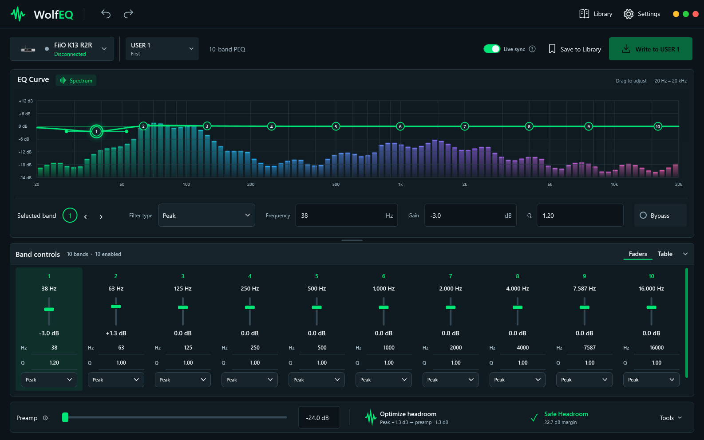
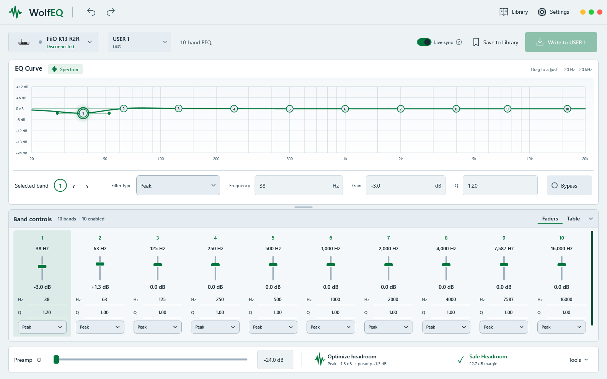

<p align="center"></p>
<h1 align="center">WolfEQ</h1>
<p align="center"><strong>Your music. Your curve. Your workspace.</strong><br/>A Windows parametric EQ editor for FiiO and Snowsky devices, and for any Windows output through Equalizer APO.</p>
<p align="center">
  <a href="https://github.com/audioslayer/wolfeq/releases/latest"></a>
  
  
  
</p>
<p align="center">
  <a href="https://github.com/audioslayer/wolfeq/releases/latest">Download</a> &bull;
  <a href="CHANGELOG.md">Changelog</a> &bull;
  <a href="https://discord.com/channels/1467241109657751737/1503967391581995069">Discord app channel</a> &bull;
  <a href="https://github.com/audioslayer/wolfeq/issues">Report an issue</a>
</p>

## ✨ Meet WolfEQ 0.8.0 beta

No FiiO DAC? No problem. **Windows System EQ** brings WolfEQ's headphone library, AutoEQ search, and curve editor to any Windows output: laptop jacks, USB dongles, other brands' DACs, and Bluetooth headphones. WolfEQ drives [Equalizer APO](https://sourceforge.net/projects/equalizerapo/) for you, so edits play live without touching a config file. FiiO and Snowsky support works exactly as before.

| | New in 0.8.0 |
|---|---|
| 🖥️ **Windows System EQ** | Pick it in the device list, choose your outputs, and hear every edit within a moment. |
| 📦 **Equalizer APO included** | The official installer ships with WolfEQ; one button starts setup. |
| ⏯️ **Bypass anywhere** | Compare EQ on and off from the app or the tray, without losing your curve. |
| 🤝 **Plays well with Peace** | WolfEQ keeps to its own file and one marked line, and warns about stacked EQ. |
| ⌨️ **Automation** | `--system-eq-bypass` and `--preset` for Stream Deck and scripts. |

Still here from 0.7.0: the redesigned workspace, colorful live spectrum bars, light and dark backgrounds, and a faster path from finding a preset to making it yours.



*App render with an illustrative spectrum. Band controls start collapsed; expand them when you want hands-on faders or a table.*

| | Workspace highlights |
|---|---|
| 🎚️ **Make room for your mix** | Drag EQ nodes, edit frequency/gain/Q/filter shape, and resize Band controls live with the divider. |
| 🎶 **See what's playing** | Colorful spectrum bars behind the curve, with smooth motion and a one-click toggle. |
| 🎨 **Make it yours** | Light or dark backgrounds, green by default, solid accents, and Aurora, Sunset, Neon, and Ocean palettes. |
| 📚 **Find, name, and open** | A compact library, naming before saving, Curve/Table online previews, and local names for device slots. |
| ⌨️ **One-button switching** | A Windows ScriptDeck setup flyout generates a ready-to-paste PowerShell command for your saved device. |
| ✨ **Details that connect** | Theme-aware icons, device thumbnails, selected-band highlights, subtle glows, and a larger transparent app/tray logo. |

<details>
<summary><strong>See light mode</strong></summary>



Choose **Settings → Appearance → Background**. Background mode is saved, and accent colors adapt for readable contrast.
</details>

## 🚀 Download

**[Get the latest release](https://github.com/audioslayer/wolfeq/releases/latest)**

- **[Windows x64 installer](https://github.com/audioslayer/wolfeq/releases/download/v0.8.0-beta/WolfEQ-Setup-0.8.0-beta.exe)** — normal installation and shortcuts.
- **[Portable Windows x64 ZIP](https://github.com/audioslayer/wolfeq/releases/download/v0.8.0-beta/WolfEQ-0.8.0-beta-win-x64.zip)** — extract everything, then run `WolfEQ.exe`.
- Both include the .NET runtime and the official Equalizer APO 1.4.2 x64 installer for Windows System EQ. SHA-256 checksums are supplied with the release.

## 🔌 First session

Using a FiiO or Snowsky device? Follow the steps below. Using anything else, such as a laptop jack, another DAC, or Bluetooth headphones? Start with [Windows System EQ](#-windows-system-eq).

1. Connect your DAC over USB. In **Settings → Device → Connections**, refresh the list, select your device, and save the connection.
2. For supported K13 lighting controls, select its Bluetooth connection too. Use **Identify** to confirm you have the same unit.
3. Open **Library**. Choose a saved preset, or search AutoEQ and OPRA through **Discover Online** and inspect its **Curve** or **Table** preview.
4. Choose **Open in editor**. Opening a preset closes the library; browsing alone does not replace your edits.
5. Shape the curve or expand **Band controls**. Use **Optimize headroom** to make room for boosts, then **Save to Library** to choose a name.
6. Select the intended USER slot and write when ready. On supported devices, **Live sync** sends edits automatically; its question-mark tooltip explains the behavior.

The **Tools** menu groups editing, A/B comparison, device preparation, and sharing. Undo/redo is available in the title bar and with **Ctrl+Z / Ctrl+Y**. Import/export includes Equalizer APO, FiiO XML, and JSON workflows.

## 💻 Windows System EQ

Windows System EQ applies WolfEQ's EQ to any Windows playback output you choose, using [Equalizer APO](https://sourceforge.net/projects/equalizerapo/) as the audio engine. The library, AutoEQ and OPRA search, graph, band controls, undo/redo, and presets all work the same as with a DAC. There are no USER slots to write: edits reach your outputs within about a quarter of a second, and the EQ keeps playing after WolfEQ closes.

**Setup**

1. In the device list (**Settings → Device**), choose **Windows System EQ**. WolfEQ remembers this choice.
2. If Equalizer APO is not installed, choose **Install Equalizer APO**. Windows asks for administrator permission, then the official Equalizer APO 1.4.2 installer bundled with WolfEQ runs.
3. In Equalizer APO's **Device Selector**, tick each output you want to EQ (for example *Speakers* or *Headphones*) and close it.
4. Restart Windows if the installer asks you to.
5. Back in WolfEQ, tick the same outputs in the System EQ output list. Each output shows whether Equalizer APO is active on it. Use **Add outputs** to reopen the Device Selector later.

Nothing is applied until at least one output is ticked.

**Bypass.** Turn the EQ off and on from the editor or the tray without losing your curve. Bypass is remembered across restarts. Choosing a FiiO device again, or **Remove from Equalizer APO**, removes WolfEQ's EQ from Equalizer APO.

**Coexistence with Peace and hand-written configs.** WolfEQ keeps its EQ in its own `WolfEQ.txt` file and adds one marked block to Equalizer APO's `config.txt`. The rest of `config.txt` is left alone, and WolfEQ restores its block if another tool rewrites the file. If Peace is also active, or a ticked output is a FiiO device that may already have EQ on board, WolfEQ shows a double-EQ warning. It does not block you; turn one of them off if the sound is doubled.

**Limitations**

- Apps that use **exclusive mode** (WASAPI exclusive) or **ASIO** bypass Equalizer APO, so they play without System EQ. There is no workaround.
- Windows feature updates and audio driver updates can remove Equalizer APO from an output. If an output's status changes, use **Add outputs**, tick it again, and restart if asked.
- Bluetooth headphones appear as two outputs: stereo and **hands-free** (used during calls). Tick each one you want to EQ.
- System EQ uses the editor's 10-band limit and applies the same EQ to both channels.

## 🎶 Live spectrum

The **Spectrum** toggle beside **EQ Curve** shows audio playing through the **default Windows multimedia output**. It is a visual monitor: it does not process audio or measure the DAC's final analog response. Spectrum height uses its own relative level scale, separate from the EQ gain axis.

- Enabled by default; an explicitly saved off choice is respected.
- Follows output-device changes and fades to silence when playback stops.
- Pauses capture and animation when disabled, hidden, minimized, inactive, or scrolled out of view.
- Separate drawing layers, cached colors, and precomputed FFT data reduce repeated work.

## 📚 Presets and local slot names

**My Library** includes compact search, **+ New**, and a preset-actions menu for duplicate, delete, and device writing. **Save to Library** asks for a name before saving. Online presets are saved locally before opening or writing; their previews include a read-only band table.

WolfEQ remembers descriptive names **locally for each saved USB device and slot**. They appear in the slot picker, selected-slot subtitle, and tray quick profiles. These labels stay on your PC; they are not names written into device firmware.

## 📌 System tray

Click or right-click the green waveform for quick access to saved USER slots and their local names. Double-click it or choose **Open editor** to return to the workspace.

- **Close to tray** defaults on; **Minimize to tray** defaults off. Both preferences are saved.
- **Quit** exits the app and checks for unsaved edits.
- The active indicator reflects the confirmed device slot. Optional saved profile lighting follows confirmed switches.

In Windows System EQ mode, the tray shows a bypass toggle and the System EQ status instead of USER slots.

Tray and automation switches select EQ **already stored on the device**. Save or discard editor changes before switching; use the editor to write a library preset into a slot.

## ⌨️ Stream Deck setup

In **Settings → Integrations**, open **Windows ScriptDeck setup**:

1. Follow the link to [Windows ScriptDeck by Start-Automating](https://marketplace.elgato.com/product/windows-scriptdeck-857f01dd-8fd4-44d5-8ec7-67ac850b21d3) in the Elgato Marketplace.
2. Choose the USER slot to switch to.
3. Copy the generated PowerShell script. WolfEQ fills in its executable location and saved USB device path, with argument quoting handled for you.
4. Add the plugin's script action to a Stream Deck key and paste the script into **On Press**. Repeat for other slots.

Re-copy scripts if you move WolfEQ or change its saved connection. For lighting, save the Bluetooth connection and enable **Apply saved lighting when switching USER slots** under **Profile Lights**.

The existing **Save shortcut** workflow is also available: assign the exported `.lnk` to Stream Deck's **System → Open** action.

<details>
<summary><strong>Command-line automation and exit codes</strong></summary>

```text
WolfEQ.exe --slot 2
WolfEQ.exe --device "Desk K13" --slot 3
WolfEQ.exe --list-devices
WolfEQ.exe --help
WolfEQ.exe --system-eq-bypass toggle
WolfEQ.exe --preset "My Headphones"
```

In Windows System EQ mode, `--system-eq-bypass on|off|toggle` controls bypass and `--preset "<name>"` loads a library preset by name and applies it to your chosen outputs. `--slot` is not available in System EQ mode and returns a clear "not available in System EQ mode" result. An unknown preset name returns an error.

`--device` accepts the saved connection name or exact USB path. It must match the saved connection and never silently reassigns Bluetooth. Existing instances receive requests without taking focus; cold commands run without opening the editor.

Exit codes: **0** success, **1** failure/disconnected, **2** invalid arguments/unsupported slot, **3** busy/unsaved edits, **4** slot switched but lighting failed.

Results are also written to `%LOCALAPPDATA%\WolfEQ\automation-result.json`. Use PowerShell `Start-Process -Wait -PassThru` when you need the GUI executable's exit code.
</details>

---


## 🎧 Device Support

| Device | Status | Notes |
|-|-|-|
| Windows System EQ | 🆕 Beta | Any Windows playback output through Equalizer APO 1.4.2 (bundled installer). Live edits, bypass, 10-band PEQ, no USER slots. See [Windows System EQ](#-windows-system-eq). |
| FiiO K13 R2R | ✅ WolfEQ verified | Main tested target. USB detection, EQ readback, USER slot switching, PEQ writes, global preamp writes, preset storage, LED cues, USB/COAX input switching. |
| FiiO BR15 R2R | ⚠️ Experimental | Community-sourced 10-band layout and USER 1-10 save path. Save-only until WolfEQ readback is physically verified. |
| FiiO QX13 | ⚠️ Experimental | Community-sourced 10-band layout and USER 1-10 save path. Save-only until WolfEQ readback is physically verified. |
| FiiO BTR17 | ⚠️ Experimental | Community-sourced 10-band USER 1-10 layout with V2 `0x21` save command. Save-only until physically verified. |
| FiiO BTR13 | ⚠️ Experimental | Community-sourced 10-band layout with USER 1-3. Save-only until WolfEQ readback is physically verified. |
| FiiO KA15 | ⚠️ Experimental | Device profile, slot map, 10-band PEQ layout, USB EQ path. Needs real-device testing. |
| FiiO KA17 | ⚠️ Experimental | Device profile, slot map, 10-band PEQ layout, USB EQ path. Needs real-device testing. |
| FiiO JA11 | ⚠️ Experimental | Device profile, 5-band PEQ layout, core filter support. Needs real-device testing. |
| Snowsky Melody | ⚠️ Experimental | 10-band PEQ and USER 1-3 writes. Automatic EQ readback and Load from slot are disabled because the device does not answer the required read command. Readback remains unavailable by design. |
| Snowsky Retro Nano | ⚠️ Experimental | Product-name matched profile, slot map, 10-band PEQ layout. Needs real-device testing. |

For full Windows audio format support, set the K13 to **UAC2.0** mode.
FiiO documents that enabling K13 R2R PEQ limits playback to PCM 192 kHz/24-bit, disables MQA processing, and can briefly reconnect USB when switching between EQ Off and an active EQ mode.

The BR15 R2R, QX13, BTR17, and BTR13 layouts are adapted from the 0BSD-licensed [DevicePEQ](https://github.com/jeromeof/devicePEQ) project and cross-checked against FiiO's published PEQ documentation. See [THIRD_PARTY_NOTICES.md](THIRD_PARTY_NOTICES.md). Upstream configuration is evidence for an experimental profile, not a substitute for WolfEQ hardware verification.

K15, K17, and K19 are not listed as supported because their dedicated serial/RS232 control path needs a separate transport implementation. K11 R2R support likewise needs the separate WalkPlay protocol rather than WolfEQ's current FiiO HID handler.

---

## Security and Data Safety

- Preset, library, settings, online-profile, release-metadata, and installer sizes are bounded before parsing or saving.
- FiiO XML import prohibits DTD/entity expansion; imported numeric values are normalized to safe finite ranges.
- Local library, lighting, and BLE cache updates use atomic replacement to reduce corruption after an interrupted save.
- AutoEQ, OPRA, and application-update downloads are restricted to their expected HTTPS hosts and repository paths.
- Update downloads use unique temporary paths, enforce a 250 MB limit, and must have a Windows executable header.
- FiiO writes validate the device profile, writable slot, band number, filter support, numeric ranges, HID report size, and response timeout.
- Application logs escape line breaks, truncate oversized entries, and rotate at 5 MB.
- The bundled Equalizer APO installer is the unmodified upstream file. The release build refuses to package it unless its SHA-256 matches the pinned 1.4.2 value. System EQ writes only `WolfEQ.txt` and one marked block in Equalizer APO's `config.txt`, using atomic replacement.

WolfEQ does not upload local presets or device data. Online search and update checks contact the providers named above. Installer code signing or published checksum verification remains recommended for a stable release.

---

## 🧪 Beta Notes

This is beta software, and every profile except K13 R2R is intentionally marked **experimental** in WolfEQ. The BR15 R2R, QX13, BTR17, and BTR13 profiles begin in save-only mode: automatic readback and live writes stay disabled until their Windows HID behavior is confirmed on physical hardware.

If you test an experimental profile:

1. Select the exact device model in Settings and use **Reconnect device**.
2. Start with a flat or low-gain profile and an unused USER slot.
3. Confirm the selected slot on the device before choosing **Write to USER**.
4. Report the Windows version, device firmware, USB mode, selected slot, and whether the device stayed connected.
5. Attach `%LOCALAPPDATA%\WolfEQ\logs\wolfeq.log` when reporting a failure.

K13 controls still being explored:

- front-panel LCD text
- volume control
- EQ on/off switching
- NOS / OS / SAM mode switching
- optical and Bluetooth input switching

Please open an issue if something breaks or feels strange. Include your Windows version, device model, USB mode, and the exact preset/slot action you were doing.

---

## 🛠️ Build

```powershell
git clone https://github.com/audioslayer/wolfeq.git
cd wolfeq
dotnet build WolfEQ.csproj
dotnet run --project WolfEQ.csproj
```

Run the regression suite and dependency vulnerability audit:

```powershell
dotnet test tests\WolfEQ.Tests\WolfEQ.Tests.csproj
dotnet list WolfEQ.csproj package --vulnerable --include-transitive
```

For a local build-and-launch from a mapped drive or network share, use `deploy.bat`. It keeps WPF intermediate files under `%LOCALAPPDATA%\WolfEQ\deploy-build` so switching between drive letters and UNC paths cannot leave stale generated-source references.

If an older checkout reports missing `Views\*.g.cs` files, close any active build, remove the generated `obj` folder, and run the current `deploy.bat` again.

Build the installer with Inno Setup 6 installed:

```powershell
.\build-installer.bat
```

---

## 📄 License

MIT. See [LICENSE](LICENSE) for details.

---

<p align="center">
  Built by <a href="https://github.com/audioslayer">Tyson Wolf</a><br/>
  <a href="https://www.buymeacoffee.com/audioslayer">Buy me a coffee</a>
</p>
