<p align="center"></p>
<h1 align="center">WolfEQ</h1>
<p align="center"><strong>Your music. Your curve. Your workspace.</strong><br/>A Windows parametric EQ editor for 19 DACs and earphones from FiiO, Snowsky, JadeAudio, TRN, CrinEar and Tanchjim, and for any Windows output through Equalizer APO.</p>
<p align="center">
  <a href="https://github.com/audioslayer/wolfeq/releases/latest"></a>
  
  
  
</p>
<p align="center">
  <a href="https://github.com/audioslayer/wolfeq/releases/latest">Download</a> &bull;
  <a href="CHANGELOG.md">Changelog</a> &bull;
  <a href="https://discord.gg/nvkCRtK2Hf">Join the Discord</a> &bull;
  <a href="https://github.com/audioslayer/wolfeq/issues">Report an issue</a>
</p>

## ✨ Meet WolfEQ 1.0

Every band has its own color, and the light follows your hand. Grab a knob or a point on the graph and your cursor becomes part of it, with the numbers moving beside it. And WolfEQ now speaks to far more than the K13: **19 devices** are supported.

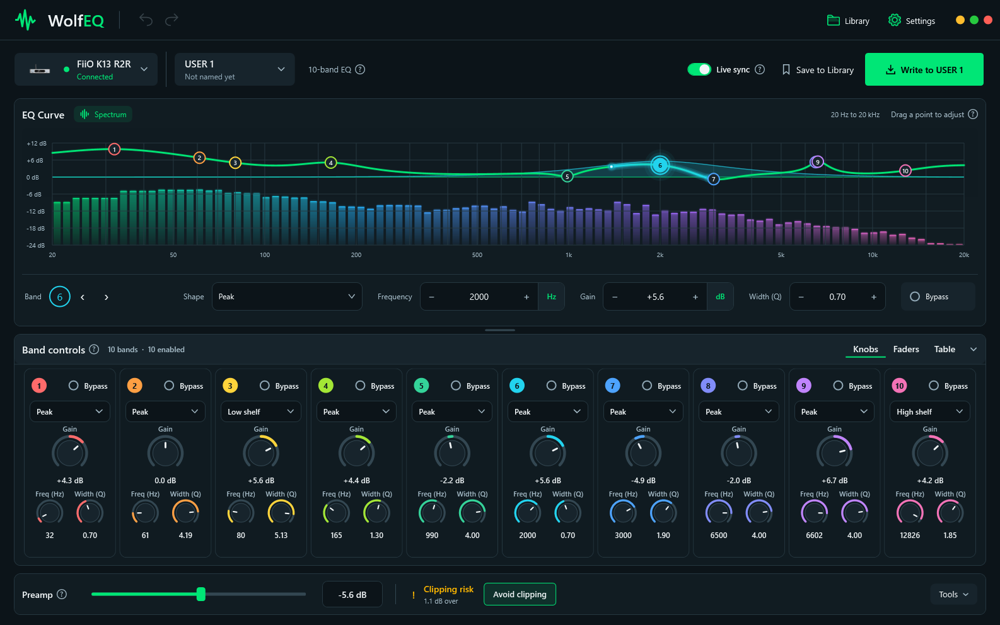

| | New in 1.0 |
|---|---|
| 🌈 **A color for every band** | Graph points, knobs, faders and the band editor share one color per band, warm lows to cool highs. |
| 🎚️ **Knobs** | The new default view. Your cursor flies into the knob and the light follows it around the dial. Type exact values any time. |
| 🪽 **Width wings** | The selected band's wings follow the curve. Drag a tip, or scroll even while dragging a point, to make it wider or narrower. |
| 🔢 **Live readout** | Frequency, gain and Q appear beside the point as you drag. |
| 🎧 **More devices** | JadeAudio JIEZI, Snowsky Tiny A, TRN Black Pearl, CrinEar Protocol Max and Tanchjim SPACE II, each with its own picture. |
| 🔊 **Right level** | The KA15, JA11 and Melody no longer play 12 dB too quiet. |
| 🎛️ **Tidier settings** | Settings show only what your device can do. |

<p align="center">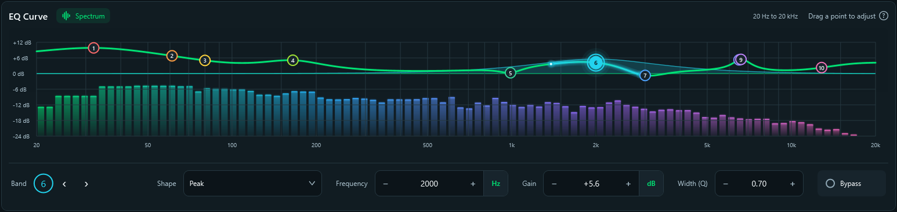<br/><em>The selected band, its shape and its width wings</em></p>

<table>
  <tr>
    <td width="50%">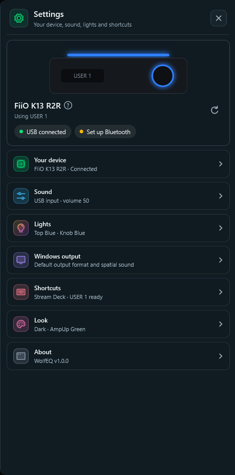</td>
    <td width="50%">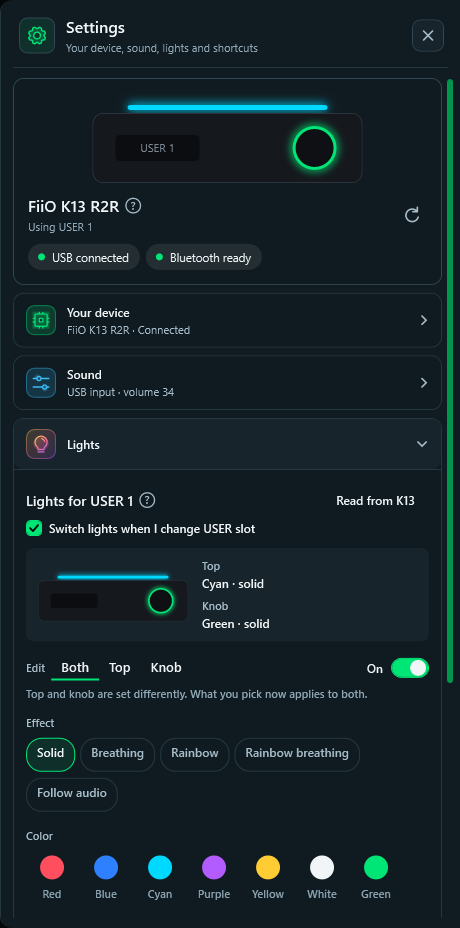</td>
  </tr>
  <tr>
    <td align="center"><em>Settings: your device first</em></td>
    <td align="center"><em>Lights: preview, effects and colors</em></td>
  </tr>
  <tr>
    <td width="50%">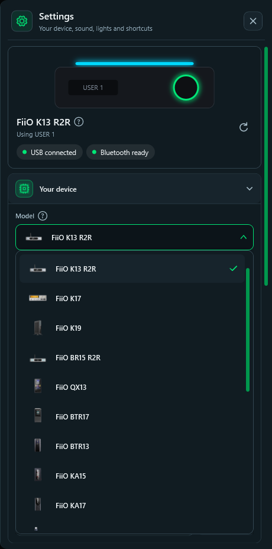</td>
    <td width="50%">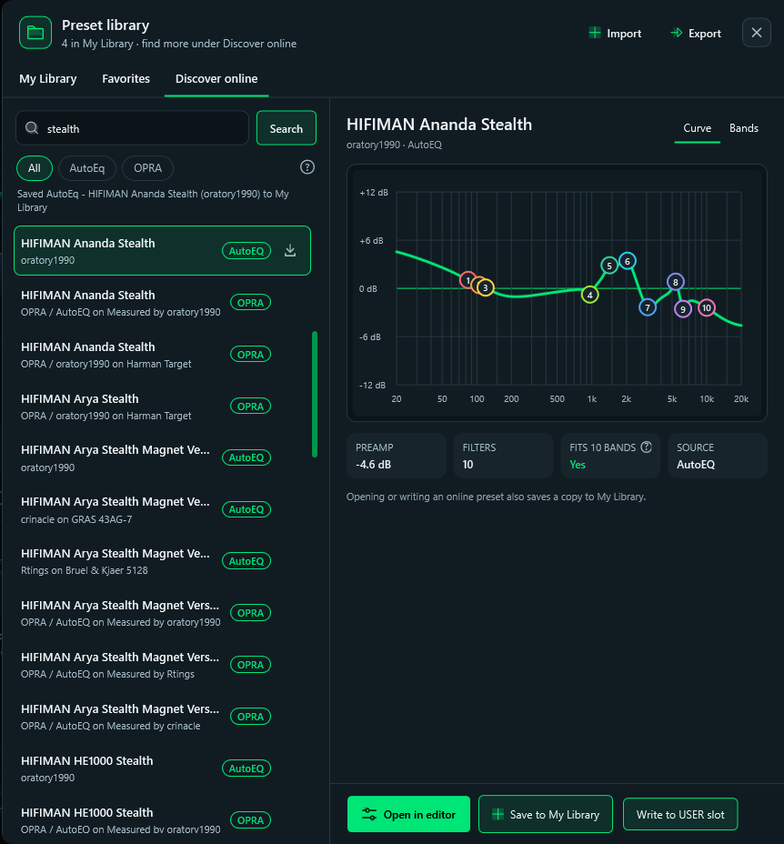</td>
  </tr>
  <tr>
    <td align="center"><em>Every device has its picture</em></td>
    <td align="center"><em>Preset library</em></td>
  </tr>
</table>

Also in WolfEQ: **Software EQ** for any Windows output, a lights editor, Bluetooth setup in one click, a step-by-step Stream Deck guide, and preset and bypass automation.

| | Workspace highlights |
|---|---|
| 🎚️ **Make room for your mix** | Drag EQ nodes, edit frequency/gain/Q/filter shape, and resize Band controls live with the divider. |
| 🎶 **See what's playing** | Colorful spectrum bars behind the curve, with smooth motion and a one-click toggle. |
| 🎨 **Make it yours** | Light or dark backgrounds, green by default, solid accents, and Aurora, Sunset, Neon, and Ocean palettes. |
| 📚 **Find, name, and open** | A compact library, naming before saving, Curve/Table online previews, and local names for device slots. |

<details>
<summary><strong>See light mode</strong></summary>

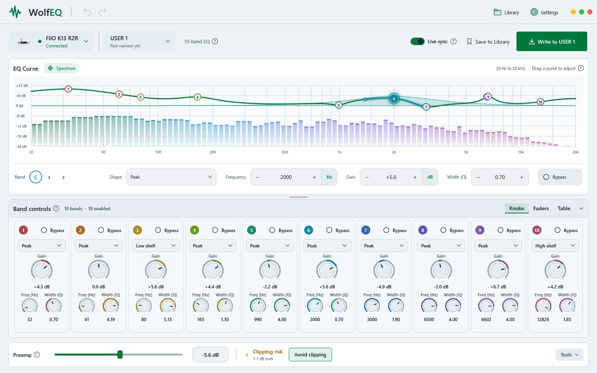

Choose **Settings → Look → Background**. Background mode is saved, and accent colors adapt for readable contrast.
</details>

## 🚀 Download

**[Get the latest release](https://github.com/audioslayer/wolfeq/releases/latest)**

- **[Windows x64 installer](https://github.com/audioslayer/wolfeq/releases/download/v1.0.0/WolfEQ-Setup-1.0.0.exe)** — normal installation and shortcuts.
- **[Portable Windows x64 ZIP](https://github.com/audioslayer/wolfeq/releases/download/v1.0.0/WolfEQ-1.0.0-win-x64.zip)** — extract everything, then run `WolfEQ.exe`.
- Both include the .NET runtime and the official Equalizer APO 1.4.2 x64 installer for Software EQ. SHA-256 checksums are supplied with the release.

## 🔌 First session

Using a supported DAC? Follow the steps below. Using anything else, such as a laptop jack, another DAC, or Bluetooth headphones? Start with [Software EQ](#-software-eq).

1. Connect your DAC over USB. In **Settings → Your device**, refresh the USB list, select your device, and choose **Save USB device**.
2. For K13 lights and input switching, choose **Find my K13** under Bluetooth. Your K13 flashes green; choose **Yes, use it**.
3. Open **Library**. Choose a saved preset, or search AutoEQ and OPRA on the **Discover online** tab and check its **Curve** or **Bands** preview.
4. Choose **Open in editor**. Opening a preset closes the library; browsing alone does not replace your edits.
5. Shape the curve or expand **Band controls**. Use **Avoid clipping** to make room for boosts, then **Save to Library** to choose a name.
6. Select the intended USER slot and write when ready. On supported devices, **Live sync** sends edits automatically; hover its **?** for a short explanation.

The **Tools** menu groups editing, A/B comparison, device preparation, and sharing. Undo/redo is available in the title bar and with **Ctrl+Z / Ctrl+Y**. **Import** and **Export** at the top of the library cover Equalizer APO / Peace, FiiO XML, WolfEQ JSON, and library backups.

## 💻 Software EQ

Software EQ applies WolfEQ's EQ to any Windows playback output you choose, using [Equalizer APO](https://sourceforge.net/projects/equalizerapo/) as the audio engine. The library, AutoEQ and OPRA search, graph, band controls, undo/redo, and presets all work the same as with a DAC. There are no USER slots to write: edits reach your outputs within about a quarter of a second, and the EQ keeps playing after WolfEQ closes.

**Setup**

1. Choose **Software EQ** from the device menu in the toolbar (or **Settings → Your device**). WolfEQ remembers this choice.
2. If Equalizer APO is not installed, choose **Install Equalizer APO**. WolfEQ uses the official Equalizer APO 1.4.2 installer it ships with (or downloads and verifies it if missing) and shows progress. Windows asks for administrator permission.
3. In Equalizer APO's **Device Selector**, tick each output you want to EQ (for example *Speakers* or *Headphones*) and close it.
4. Restart Windows if the installer asks you to.
5. Back in WolfEQ, tick the same outputs in the Software EQ output list. Each output shows whether Equalizer APO is active on it. Use **Add outputs** to reopen the Device Selector later.

Nothing is applied until at least one output is ticked.

**Bypass.** Turn the EQ off and on from the editor or the tray without losing your curve. Bypass is remembered across restarts. Choosing a DAC again turns Software EQ off; **Remove from Equalizer APO** (or uninstalling WolfEQ) takes WolfEQ's EQ out of Equalizer APO completely.

**Coexistence with Peace and hand-written configs.** WolfEQ keeps its EQ in its own `WolfEQ.txt` file and adds one marked block to Equalizer APO's `config.txt`. The rest of `config.txt` is left alone, and WolfEQ restores its block if another tool rewrites the file. If Peace is also active, or a ticked output is a FiiO device that may already have EQ on board, WolfEQ shows a double-EQ warning. It does not block you; turn one of them off if the sound is doubled.

**Limitations**

- Apps that use **exclusive mode** (WASAPI exclusive) or **ASIO** bypass Equalizer APO, so they play without Software EQ. There is no workaround.
- Windows feature updates and audio driver updates can remove Equalizer APO from an output. If an output's status changes, use **Add outputs**, tick it again, and restart if asked.
- Bluetooth headphones appear as two outputs: stereo and **hands-free** (used during calls). Tick each one you want to EQ.
- Software EQ uses the editor's 10-band limit and applies the same EQ to both channels.

## 🎶 Live spectrum

The **Spectrum** toggle beside **EQ Curve** shows audio playing through the **default Windows multimedia output**. It is a visual monitor: it does not process audio or measure the DAC's final analog response. Spectrum height uses its own relative level scale, separate from the EQ gain axis.

- Enabled by default; an explicitly saved off choice is respected.
- Follows output-device changes and fades to silence when playback stops.
- Pauses capture and animation when disabled, hidden, minimized, inactive, or scrolled out of view.
- Separate drawing layers, cached colors, and precomputed FFT data reduce repeated work.

## 📚 Presets and local slot names

Open **Library** for your presets on the left and a large preview on the right: the curve or a band table, preamp, filter count, whether the preset fits your device, and where it came from.

- **My Library**, **Favorites**, and **Discover online** tabs. Saved presets can be filtered by category; online results by **AutoEQ** or **OPRA**.
- Hover a saved preset to **star** it, **rename** it (✎ or F2), or delete it. Double-click opens it in the editor.
- Hover an online result to save it to My Library without opening it.
- **Import** and **Export** sit at the top of the library: Equalizer APO / Peace text, FiiO XML, WolfEQ JSON, library backups, and a copyable tuning report.
- **Save to Library** asks for a name before saving. Online presets are saved locally before opening or writing.

WolfEQ remembers descriptive names **locally for each saved USB device and slot**. They appear in the USER slot menu, the tray, and the selected-slot subtitle. These labels stay on your PC; they are not names written into device firmware.

## 📌 System tray

Click or right-click the green waveform for the tray panel. Double-click it or choose **Open editor** to return to the workspace.

- **Now playing** shows the active slot or preset. In Software EQ mode it has an EQ switch for bypass.
- Device mode shows your USER slots as chips, with a check on the active one. Software EQ mode shows up to six quick presets, favorites first.
- **Tray options** holds **Close to tray** (on by default) and **Minimize to tray** (off by default). Both are saved.
- **Quit** exits the app and checks for unsaved edits.

Tray and automation switches select EQ **already stored on the device**. Save or discard editor changes before switching; use the editor to write a library preset into a slot.

## ⌨️ Stream Deck setup

In **Settings → Shortcuts**, pick a USER slot from the Stream Deck keys and choose **Set up this key**. A four-step guide saves a shortcut for that slot and shows where it goes in Stream Deck (**System → Open**). Repeat for each slot.

Prefer the Windows ScriptDeck plugin? Open **Advanced & troubleshooting → Windows ScriptDeck setup**:

1. Follow the link to [Windows ScriptDeck by Start-Automating](https://marketplace.elgato.com/product/windows-scriptdeck-857f01dd-8fd4-44d5-8ec7-67ac850b21d3) in the Elgato Marketplace.
2. Choose the USER slot to switch to.
3. Copy the generated PowerShell script. WolfEQ fills in its executable location and saved USB device path, with argument quoting handled for you.
4. Add the plugin's script action to a Stream Deck key and paste the script into **On Press**. Repeat for other slots.

Re-copy scripts if you move WolfEQ or change its saved connection. For lighting, save the Bluetooth connection and enable **Switch lights when I change USER slot** under **Lights**.

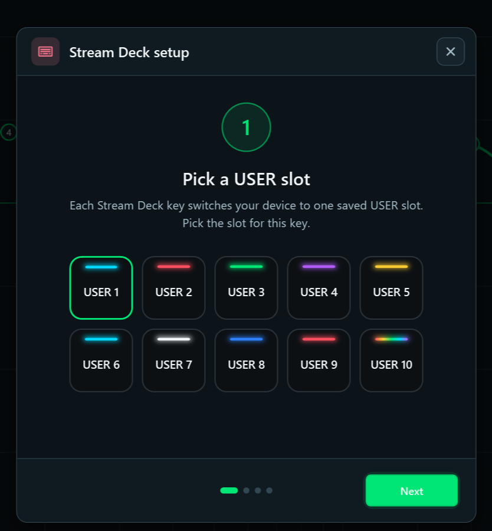

Already know the steps? **Save shortcut...** saves a slot's `.lnk` straight away; assign it to Stream Deck's **System → Open** action.

<details>
<summary><strong>Command-line automation and exit codes</strong></summary>

```text
WolfEQ.exe --slot 2
WolfEQ.exe --device "Desk K13" --slot 3
WolfEQ.exe --list-devices
WolfEQ.exe --help
WolfEQ.exe --system-eq-bypass toggle
WolfEQ.exe --preset "My Headphones"
```

In Software EQ mode, `--system-eq-bypass on|off|toggle` controls bypass and `--preset "<name>"` loads a library preset by name and applies it to your chosen outputs. `--slot` is not available in Software EQ mode and returns a clear "not available in Software EQ mode" result. An unknown preset name returns an error.

`--device` accepts the saved connection name or exact USB path. It must match the saved connection and never silently reassigns Bluetooth. Existing instances receive requests without taking focus; cold commands run without opening the editor.

Exit codes: **0** success, **1** failure/disconnected, **2** invalid arguments/unsupported slot, **3** busy/unsaved edits, **4** slot switched but lighting failed.

Results are also written to `%LOCALAPPDATA%\WolfEQ\automation-result.json`. Use PowerShell `Start-Process -Wait -PassThru` when you need the GUI executable's exit code.
</details>

---


## 🎧 Supported devices

| | Device | What you get |
|:-:|-|-|
| 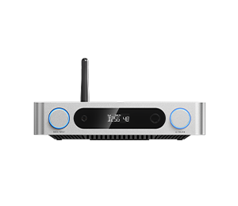 | **FiiO K13 R2R** | 10 bands, USER 1-10. Live sync, load from slot, slot names, lights, USB and COAX input switching. |
| 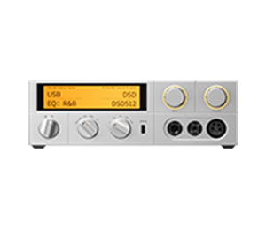 | **FiiO K17** | 31 bands, USER 1-10. |
| 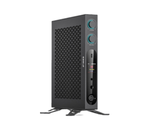 | **FiiO K19** | 31 bands, USER 1-10. |
| 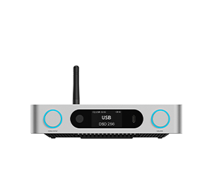 | **FiiO BR15 R2R** | 10 bands, USER 1-10. |
| 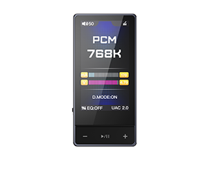 | **FiiO QX13** | 10 bands, USER 1-10. |
| 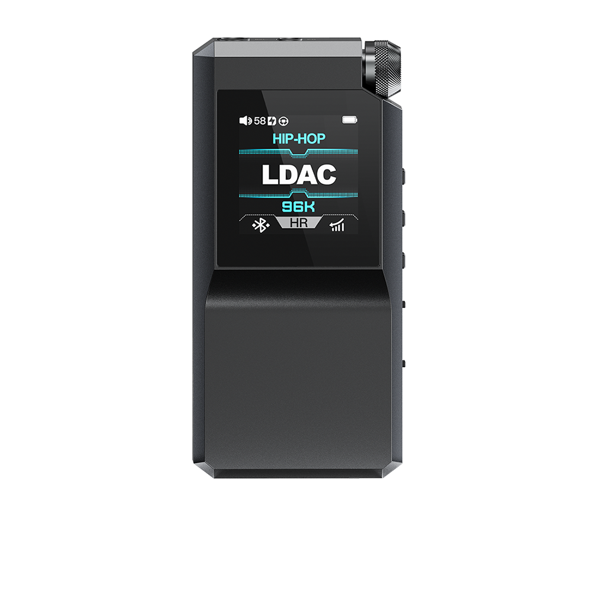 | **FiiO BTR17** | 10 bands, USER 1-10. |
| 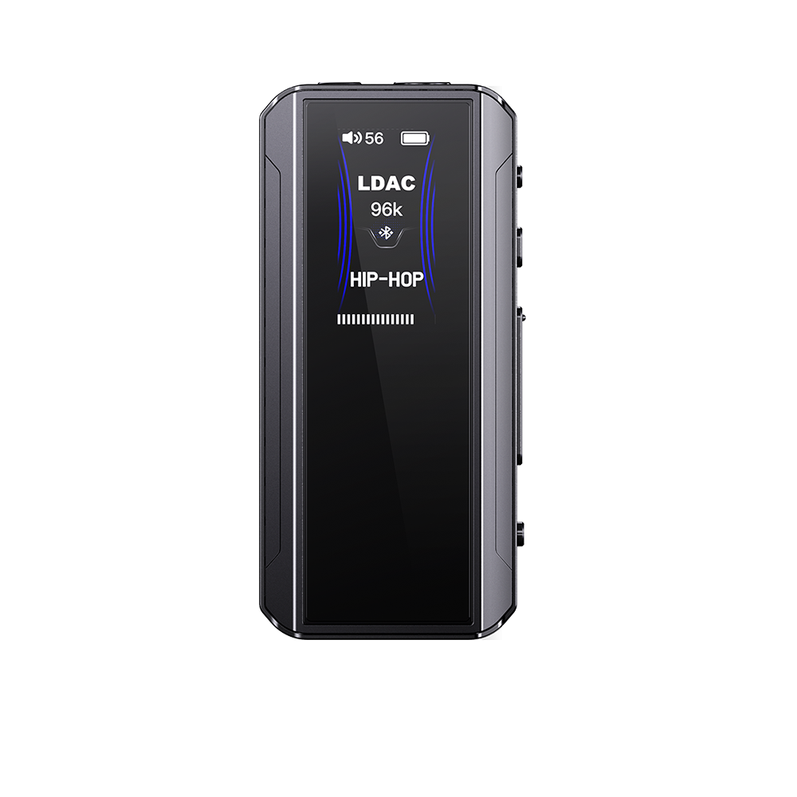 | **FiiO BTR13** | 10 bands, USER 1-3. |
| 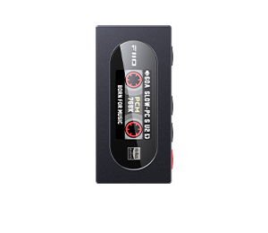 | **FiiO KA15** | 10 bands, USER 1-3. Live sync and load from slot. |
| 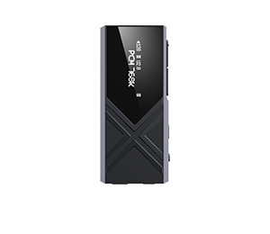 | **FiiO KA17** | 10 bands, USER 1-3. Live sync and load from slot. |
| 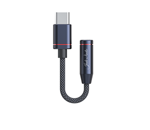 | **FiiO JA11** | 5 bands, one USER slot. Live sync and load from slot. |
| 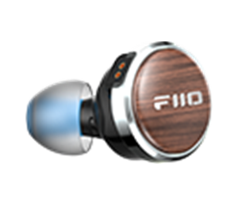 | **FiiO FP3** | 10 bands, one USER slot. |
| 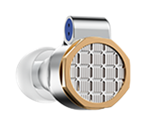 | **FiiO Oak Nano** | 8 bands, one USER slot. |
| 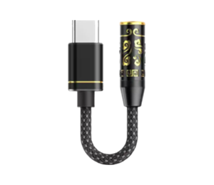 | **JadeAudio JIEZI** | 10 bands, USER 1-3. |
| 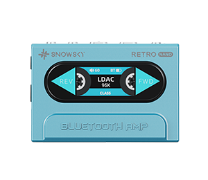 | **Snowsky Retro Nano** | 10 bands, USER 1-3. Load from slot and slot names. |
| 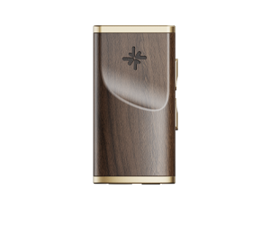 | **Snowsky Melody** | 10 bands, USER 1-3. Live sync. |
| 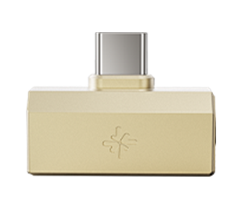 | **Snowsky Tiny A** | 10 bands, USER 1-3. |
| 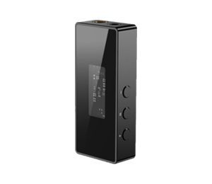 | **TRN Black Pearl** | 10 bands, one slot. Load from device; every save is read back and checked. Plug headphones in first or Windows will not see it. |
| 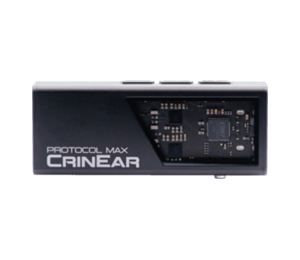 | **CrinEar Protocol Max** | 10 bands, one slot. Load from device; every save is read back and checked. |
| 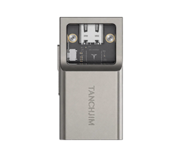 | **Tanchjim SPACE II** | 10 bands, one slot. Load from device; every save is read back and checked. |
|  | **Any Windows output** | 10 bands through Equalizer APO (installer included). Live edits and bypass. See [Software EQ](#-software-eq). |

**Live sync** plays your edits on the device as you make them. On the others, choose **Write** to save your EQ to a slot.

- For full Windows audio format support, set the K13 to **UAC2.0** mode. With EQ on, FiiO limits the K13 R2R to PCM 192 kHz / 24-bit, turns MQA off, and can briefly reconnect USB when you switch EQ.
- The K17 and K19 are found when they connect as USB HID. The K15 and K11 R2R are not supported yet.

WolfEQ is developed on the K13 R2R. Other devices build on published work by [DevicePEQ](https://github.com/jeromeof/devicePEQ) (0BSD), [Contour](https://github.com/Chronosauros/contour) (Apache-2.0) and fiioctl (MIT). Thank you! See [THIRD_PARTY_NOTICES.md](THIRD_PARTY_NOTICES.md).

---

## Security and Data Safety

- Preset, library, settings, online-profile, release-metadata, and installer sizes are bounded before parsing or saving.
- FiiO XML import prohibits DTD/entity expansion; imported numeric values are normalized to safe finite ranges.
- Local library, lighting, and BLE cache updates use atomic replacement to reduce corruption after an interrupted save.
- AutoEQ, OPRA, and application-update downloads are restricted to their expected HTTPS hosts and repository paths.
- Update downloads use unique temporary paths, enforce a 250 MB limit, and must have a Windows executable header.
- FiiO writes validate the device profile, writable slot, band number, filter support, numeric ranges, HID report size, and response timeout.
- Application logs escape line breaks, truncate oversized entries, and rotate at 5 MB.
- The bundled Equalizer APO installer is the unmodified upstream file. The release build refuses to package it unless its SHA-256 matches the pinned 1.4.2 value. Software EQ writes only `WolfEQ.txt` and one marked block in Equalizer APO's `config.txt`, using atomic replacement.

WolfEQ does not upload local presets or device data. Online search and update checks contact the providers named above. Installer code signing or published checksum verification remains recommended for a stable release.

---

## 💬 Help and feedback

Using a device other than the K13 R2R? Let us know how it goes. Start with a low-gain EQ and a USER slot you don't need, and turn the volume down before your first save.

If something breaks, [open an issue](https://github.com/audioslayer/wolfeq/issues) with your Windows version, device model and firmware, the slot you used, and `%LOCALAPPDATA%\WolfEQ\logs\wolfeq.log`.

---

## 🛠️ Build

```powershell
git clone https://github.com/audioslayer/wolfeq.git
cd wolfeq
dotnet build WolfEQ.csproj
dotnet run --project WolfEQ.csproj
```

Run the regression suite and dependency vulnerability audit:

```powershell
dotnet test tests\WolfEQ.Tests\WolfEQ.Tests.csproj
dotnet list WolfEQ.csproj package --vulnerable --include-transitive
```

For a local build-and-launch from a mapped drive or network share, use `deploy.bat`. It keeps WPF intermediate files under `%LOCALAPPDATA%\WolfEQ\deploy-build` so switching between drive letters and UNC paths cannot leave stale generated-source references.

If an older checkout reports missing `Views\*.g.cs` files, close any active build, remove the generated `obj` folder, and run the current `deploy.bat` again.

Build the installer with Inno Setup 6 installed:

```powershell
.\build-installer.bat
```

---

## 📄 License

MIT. See [LICENSE](LICENSE) for details.

---

<p align="center">
  Built by <a href="https://github.com/audioslayer">Tyson Wolf</a><br/>
  <a href="https://www.buymeacoffee.com/audioslayer">Buy me a coffee</a>
</p>
