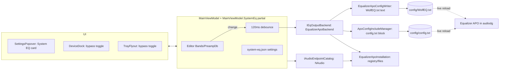

# Windows System EQ - Plan

## Goal Capsule

- **Objective:** A WolfEQ user without FiiO hardware can pick "Windows System EQ" in the device picker, choose which Windows outputs to tune, and hear their headphone EQ on those outputs as they edit it. FiiO users keep exactly the experience they have today.
- **Means:** Equalizer APO is the audio engine. WolfEQ writes its own include file and keeps one Include line in APO's `config.txt` (KTD2, KTD3).
- **Authority:** Product behavior is owned by the Requirements (R-IDs). Implementation choices are owned by the KTDs. Units override neither.
- **Stop conditions:** Stop and report if a FiiO hardware path has to change behavior to make System EQ work, if APO cannot be written without elevation on a real install, or if the plan's VM↔View contract has to change shape.
- **Execution profile:** Parallel lanes in separate git worktrees off the `feat/windows-system-eq` branch, merged by the coordinating agent. Shared contracts (U0) land before the lanes start.

## Product Contract

### Summary

Add "Windows System EQ" as a new support type next to the FiiO profiles. When it is selected, WolfEQ:
- applies the editor's EQ through Equalizer APO to the Windows outputs the user picks;
- offers a bundled APO installer when APO is missing;
- leaves the rest of APO's `config.txt` (such as Peace setups) intact.

### Problem Frame

WolfEQ is only useful today if you own a supported FiiO DAC. All of its value is FiiO-specific: the headphone library, AutoEQ import, the graph and editor, presets, and the tray. Someone who listens through a laptop jack, a USB dongle or another brand's DAC has no way to use the same headphone-matching workflow. Peace and hand-edited Equalizer APO configs do the DSP but are clumsy to use. WolfEQ already speaks APO's preset format, so APO can become a second output target instead of WolfEQ being a FiiO-only app.

### Requirements

**Support type and selection**
- R1. The device picker lists "Windows System EQ" alongside the FiiO profiles, and the choice persists across restarts.
- R2. FiiO auto-detection never switches a user out of a persisted System EQ choice. A user who picks a FiiO profile gets today's FiiO behavior unchanged.
- R3. In System EQ mode, hardware-only UI is hidden: USER slots, slot names, write-to-slot actions, live-sync toggle, BLE lights, input and device controls, and Stream Deck slot integration.

**Applying EQ**
- R4. Every editor change (bands, preamp, preset load, reset, undo/redo, profile switch) reaches the chosen outputs within about 250 ms, with no save step.
- R5. The EQ is applied only to the Windows output endpoints the user ticks in an endpoint picker. With no endpoint ticked, nothing is applied and the UI says so.
- R6. Bypass can be toggled from the app and from the tray. Bypass removes WolfEQ's effect without losing the user's EQ, persists across restarts, and the EQ keeps applying after WolfEQ exits unless bypassed.
- R7. The editor keeps its 10-band, -24..+12 dB, Q 0.1–10 limits. All seven filter types produce valid APO filter lines.

**Engine install and health**
- R8. When APO is missing, a setup card offers to run the bundled Equalizer APO installer. Afterwards it guides the user through APO's device selector and any reboot, then re-checks.
- R9. WolfEQ shows per-endpoint status: APO active, APO not installed on this output (offer "Add outputs", which re-runs the device selector), or "Audio enhancements disabled".
- R10. WolfEQ touches only its own include file plus a single marked block in `config.txt`. It repairs that block if another tool such as Peace rewrites the file, and removes it cleanly when the user leaves System EQ mode or chooses "Remove from Equalizer APO".

**Safety and coexistence**
- R11. When a chosen output is a FiiO device, or Peace's include is also active, WolfEQ shows a double-EQ warning. It does not block.
- R12. If the APO config folder cannot be written, WolfEQ explains why and stops trying. The editor keeps working and no partial file is left behind.

**Automation and release**
- R13. The command-line automation can toggle bypass and apply a library preset by name in System EQ mode. `--slot` reports a clear "not available in System EQ mode" result.
- R14. The installer ships the unmodified Equalizer APO x64 installer with its GPL-2 notice and source link, and the README and CHANGELOG describe the 0.8.0-beta feature.

### Key Decisions

- **Equalizer APO is the engine. WolfEQ does not ship its own APO or driver.** Governs R4, R8. (session-settled: user-approved — chosen over building a WolfEQ APO/virtual driver: months of signed native work for no user-visible gain)
- **Bundle the official APO installer.** Governs R8, R14. (session-settled: user-directed — chosen over detect-and-link: smoother first run, at the cost of GPL notice and version pinning)
- **The name is "Windows System EQ".** Governs R1. (session-settled: user-directed — chosen over "Software EQ", "WolfEQ Anywhere", "Any Device (Windows)")
- **The user picks the target endpoints.** Governs R5. (session-settled: user-directed — chosen over following the default device or applying to all APO devices)
- **WolfEQ owns its own include file and never takes over `config.txt`.** Governs R10, R11. (session-settled: user-directed — chosen over backing up and owning `config.txt`: Peace and hand-written configs keep working)

### Scope Boundaries

- Not in scope: a WolfEQ-native APO or virtual audio driver, macOS/Linux, per-application EQ, importing Peace profiles automatically, more than 10 bands, or channel-specific EQ.
- Not in scope: refactoring `FiioK13DeviceService` behind an interface. The FiiO path stays as it is (KTD1).

#### Deferred to Follow-Up Work

- Raise the System EQ band limit above 10 once the editor supports variable band counts.
- Peace profile importer (reading `.peace` and `peace.txt` into the library).
- Signed installer and checksum verification of the bundled APO exe at install time.

### Success Criteria

- On a clean Windows 11 machine with no FiiO device, a user can go from installing WolfEQ to hearing a library preset on their headphones without editing any file.
- Every existing test still passes. A FiiO K13 session (detect, load slot, live edit, save to USER slot) behaves the same as 0.7.0-beta.

## Planning Contract

### Key Technical Decisions

- KTD1. **System EQ is a `FiioDeviceProfile` instance (`Id = "windows-system-eq"`) defined in a new `Models/SystemEqProfiles.cs`.** It is appended to `MainViewModel.DeviceProfiles` and kept out of `FiioDeviceProfiles.All`.
  - **Profile settings:** 10 bands, -24..+12 dB, Q 0.1–10, all filter types, no slots, `SupportsLiveEqWrites=false`, `SupportsEqReadback=false`, `IsVerified=true`.
  - **Why:** the graph, preamp slider, `BandControls.Profile`, and the filter-type picker all bind to `FiioDeviceProfile`. Reusing the record keeps them untouched, and leaving it out of `All` means `FiioDeviceProfiles.Match` can never return it.
  - **VM flag:** `IsSystemEqSelected` is the single mode switch.
- KTD2. **A new `IEqOutputBackend` seam is used only by System EQ, implemented by `EqualizerApoBackend`.** The FiiO service is not wrapped, since that would touch about 25 call sites for no gain in this feature. The contract (U0) is a full-snapshot `ApplyAsync(preset, endpoints, bypassed)`, plus `GetStatusAsync()` and `RemoveAsync()`.
- KTD3. **The include file is `WolfEQ.txt` in APO's `ConfigPath`, read from `HKLM\SOFTWARE\EqualizerAPO`.** `config.txt` gets one marked block inserted at the top: `# >>> WolfEQ (managed) >>>`, `Device: all`, `Include: WolfEQ.txt`, `# <<< WolfEQ <<<`.
  - **Why the top:** `Device: all` keeps an earlier non-matching `Device:` line from hiding our include.
  - **Why the config folder:** APO only watches its own folder tree.
  - **Repair:** the block is re-checked at startup, after every apply, and from a `FileSystemWatcher` on `config.txt`, then re-inserted if missing (R10).
- KTD4. **Endpoint scoping lives inside `WolfEQ.txt` as `Device: {guid1}; {guid2}`.** The GUID is the trailing `{…}` of the `IMMDevice` id. `Device:` inside an included file does not leak into the parent. If no endpoint is selected, the file contains only the header comment.
- KTD5. **Bypass rewrites `WolfEQ.txt` with header comment only and leaves the `config.txt` block alone.** This makes bypass instant through APO's live reload, and turning it off restores the snapshot. Bypass state persists in `system-eq.json`.
- KTD6. **Filter-line grammar, owned by `EqualizerApoConfigWriter`:**
  - **Line formats:** Peak → `PK Fc f Hz Gain g dB Q q`. LowShelf/HighShelf → `LSC`/`HSC Fc f Hz Gain g dB Q q`. BandPass → `BP Fc f Hz Q q`. LowPass/HighPass → `LPQ`/`HPQ Fc f Hz Q q`. AllPass → `AP Fc f Hz Q q`.
  - **Disabled bands** emit `OFF`.
  - **Number format:** InvariantCulture with at most 2 decimals. A 3-decimal Fc is misread as a thousands separator.
  - **Encoding:** UTF-8 without BOM.
  - **Existing codec unchanged:** `EqualizerApoPresetCodec.Export` keeps its behavior for clipboard and file export.
- KTD7. **APO writes are atomic.** Write to a temp file in the same folder, then `File.Replace`/`Move` with overwrite, retrying up to 5× over about 200 ms on sharing violations. APO reads with share-read and reloads within about 10 ms. Reuse the `AtomicFileWriter` pattern, but add the retry in the backend.
- KTD8. **The System EQ pipeline is separate from FiiO live sync.**
  - **Where:** a new partial `ViewModels/MainViewModel.SystemEq.cs` watches `Bands` (collection and items) and `PreampDb`.
  - **Debounce:** its own 120 ms `DispatcherTimer`, then `backend.ApplyAsync(BuildEditorPresetSnapshot())`. It fires on loads as well, because `_isLoadingPreset` loads must apply in System EQ (R4).
  - **FiiO side:** the FiiO `QueueLive*`/`Flush` methods early-return when `IsSystemEqSelected`.
- KTD9. **System EQ settings live in `%LOCALAPPDATA%\WolfEQ\system-eq.json`** (`selected`, `endpointIds[]`, `bypassed`). The file is written with `AtomicFileWriter` and read with `BoundedTextReader`, following the `DeviceBindingSettings` pattern. At startup, if `selected` is true, `ApplyDeviceProfile(WindowsSystemEq)` runs. FiiO detection still runs, but only to feed the double-EQ warning (R2, R11).
- KTD10. **APO detection** (`EqualizerApoInstallation`):
  - **"Installed" requires all of:** the `EqualizerAPO.dll` file is present in `InstallPath`, the registry `ConfigPath` exists, and the APO CLSIDs `{EACD2258-FCAC-4FF4-B36D-419E924A6D79}` / `{EC1CC9CE-FAED-4822-828A-82A81A6F018F}` are registered under `HKCR\CLSID`. The `HKLM\SOFTWARE\EqualizerAPO` key alone is not proof, because it survives uninstall (this dev machine is in that state).
  - **"APO active on this endpoint"** means any `{d04e05a6-594b-4fb6-a80d-01af5eed7d1d},N` value under `MMDevices\Audio\Render\{guid}\FxProperties` equals one of those CLSIDs.
  - **"Enhancements disabled"** means `{1da5d803-d492-4edd-8c23-e0c0ffee7f0e},5` = 1.
  - All registry access goes through a small injectable reader so tests can fake it.
- KTD11. **The installer and device selector are launched elevated** (`ProcessStartInfo{UseShellExecute=true, Verb="runas"}`).
  - **Installer:** `redist\EqualizerAPO\EqualizerAPO-x64-1.4.2.exe` next to `WolfEQ.exe`, launched interactively (not `/S`), because APO always shows its device selector.
  - **Add outputs:** `"<InstallPath>\DeviceSelector.exe"` with no args. Exit code 1 from the installer flow means a reboot is needed.
  - **After either process exits,** WolfEQ re-runs detection.
  - **If UAC is cancelled** (Win32Exception 1223), report it calmly with no error dialog.
- KTD12. **The double-EQ warning** (R11) fires when either:
  - a selected endpoint's friendly name or device description matches any FiiO profile through `FiioDeviceProfiles.ProductNameMatches`, or contains "FiiO"; or
  - `config.txt` has an active `Include: peace.txt` line (Peace).

  It is warning text only and never blocks.
- KTD13. **Endpoint enumeration uses the NAudio.Wasapi `MMDeviceEnumerator` already referenced** (`EnumerateAudioEndPoints(Render, Active)`), returning `{Id, Guid, FriendlyName, DeviceDescription, IsDefault}`. It sits behind an `IAudioEndpointCatalog` seam so tests and the VM never touch COM.
- KTD14. **Bundling uses the publish folder.** The exe lives at `redist/EqualizerAPO/EqualizerAPO-x64-1.4.2.exe` with a `None … CopyToPublishDirectory="PreserveNewest"` csproj entry. The existing installer `[Files]` wildcard and the test-build zip then pick it up with no `.iss` change.
  - **Not in git:** the binary (~2 MB) is added to `.gitignore` and fetched by `build-installer.bat` from SourceForge.
  - **Integrity check:** the script verifies a pinned SHA-256 from the Chocolatey package and fails the build on a mismatch. `THIRD_PARTY_NOTICES.md` gains a GPL-2 section with the upstream source URL.

### High-Level Technical Design

Directional sketch of the components, not an implementation spec:



System EQ lifecycle (the mode state machine):

```text
NotSelected --pick System EQ--> Checking
Checking --APO missing--> NeedsInstall --run bundled installer--> Checking
Checking --APO ok, no endpoint has APO--> NeedsDeviceSelection --run DeviceSelector--> Checking
Checking --APO ok, write denied--> Blocked(R12)
Checking --APO ok--> Active
Active --bypass on/off--> Active (WolfEQ.txt header-only / full)
Active --pick FiiO profile or "Remove"--> NotSelected (block removed from config.txt, WolfEQ.txt deleted)
```

### Shared Contract (U0 lands this before lanes start)

**VM ↔ View names.** These are fixed; UI lanes bind to them blind.

| Member | Kind | Meaning |
|---|---|---|
| `IsSystemEqSelected` / `IsHardwareDeviceSelected` | bool | mode switch for visibility |
| `SystemEqEndpoints` | `ObservableCollection<SystemEqEndpointOption>` | `{Id, Name, Description, IsSelected (two-way), IsApoActive, EnhancementsDisabled, IsFiio, StatusText}` |
| `SystemEqBypassed` | bool, two-way | bypass (R6) |
| `ToggleSystemEqBypassCommand` | ICommand | tray/dock toggle |
| `RefreshSystemEqEndpointsCommand` | ICommand | re-enumerate + re-detect |
| `InstallEqualizerApoCommand` | ICommand | run bundled installer (R8) |
| `OpenApoDeviceSelectorCommand` | ICommand | "Add outputs" (R9) |
| `RemoveSystemEqFromApoCommand` | ICommand | remove block + file (R10) |
| `SystemEqState` | enum `SystemEqState { NotSelected, Checking, NeedsInstall, NeedsDeviceSelection, Blocked, Active }` | drives the setup card |
| `IsEqualizerApoInstalled` | bool | |
| `SystemEqStatusText` | string | one-line status for dock/tray/card |
| `SystemEqWarningText` / `HasSystemEqWarning` | string / bool | double-EQ, enhancements, blocked (R11, R12) |

**Service seams** (new files under `Services/SystemEq/`):
- `IEqOutputBackend`: `GetStatusAsync()`, `ApplyAsync(EqPreset, IReadOnlyList<string> endpointGuids, bool bypassed, CancellationToken)`, `RemoveAsync()`.
- `IAudioEndpointCatalog`: `GetRenderEndpoints()`.
- `IRegistryReader`: read string/value under HKLM/HKCR.
- Records: `SystemEqBackendStatus`, `SystemEqApplyResult`, `AudioEndpointInfo`.

### Sequencing and Lanes

U0 is serial. U1–U5 run in parallel worktrees. U6 is serial integration.

```text
U0 contracts ─┬─ U1 APO engine (Services/SystemEq/*)
              ├─ U2 endpoints + registry detection (Services/SystemEq/Endpoint*, Installation)
              ├─ U3 VM + profile + settings + automation (only lane touching MainViewModel*.cs)
              ├─ U4 UI: SettingsPopover, DeviceDock, LibraryPanel, TrayFlyout, TrayIconService
              └─ U5 packaging, icon asset, notices, docs
                         └──────────► U6 integrate, view checks, full test pass
```

File ownership is exclusive per lane. `tests/WolfEQ.Tests/StudioViewChecks.cs` and `IntegrationSettingsTests.cs` belong to U6 only.

### Risks & Dependencies

- **Peace or a user can rewrite `config.txt` and drop our block.** Mitigated by the KTD3 watcher plus repair.
- **Windows or driver updates reset FxProperties, which silently disables APO on an output.** R9 status plus the "Add outputs" button cover it.
- **Exclusive-mode and ASIO apps bypass APO.** Documented in the README; there is no fix.
- **APO version pin (1.4.2) and SHA-256 drift on SourceForge.** The build fails loudly rather than shipping an unverified exe.
- **The dev machine has APO leftovers only.** Real-install checks (U6 manual smoke) need APO installed by the user.

## Implementation Units

### U0. Shared contracts and branch prep

- **Goal:** Land the seams and VM↔View names so the lanes compile against the same shapes.
- **Requirements:** R1–R13 (contract only).
- **Files:**
  - `Services/SystemEq/IEqOutputBackend.cs` (new)
  - `Services/SystemEq/IAudioEndpointCatalog.cs` (new)
  - `Services/SystemEq/IRegistryReader.cs` (new)
  - `Services/SystemEq/SystemEqContracts.cs` (new): records plus the `SystemEqState` enum
  - `Models/SystemEqProfiles.cs` (new)
  - `ViewModels/SystemEqEndpointOption.cs` (new)
- **Approach:** Interfaces and records only, no behavior. Commit the pending 0.8.0-beta csproj bump and this plan on `feat/windows-system-eq`.
- **Test expectation:** none (contract scaffolding). The build must pass.
- **Verification:** `dotnet build WolfEQ.csproj` succeeds on the branch.

### U1. Equalizer APO engine (lane A)

- **Goal:** Turn an `EqPreset` plus endpoints plus bypass into correct `WolfEQ.txt` text, keep the `config.txt` block correct, and write both safely.
- **Requirements:** R4, R5, R6, R7, R10, R12. Follows KTD2–KTD7.
- **Dependencies:** U0.
- **Files:**
  - `Services/SystemEq/EqualizerApoConfigWriter.cs` (new, pure)
  - `Services/SystemEq/ApoConfigIncludeManager.cs` (new, pure text transform plus file IO)
  - `Services/SystemEq/EqualizerApoBackend.cs` (new, implements `IEqOutputBackend`; takes the config dir and `EqualizerApoInstallation` via ctor)
  - `tests/WolfEQ.Tests/EqualizerApoConfigWriterTests.cs` (new)
  - `tests/WolfEQ.Tests/ApoConfigIncludeManagerTests.cs` (new)
  - `tests/WolfEQ.Tests/EqualizerApoBackendTests.cs` (new, temp dir)
- **Approach:** Writer output is header comment, `Device:` line, `Preamp:`, then `Filter N:` lines. The include manager inserts, repairs and removes the marked block idempotently, and preserves every other line byte-for-byte, including the original line endings. The backend serializes writes with a `SemaphoreSlim`, retries sharing violations (KTD7), and maps `UnauthorizedAccessException` to `Blocked` status (R12). `RemoveAsync` deletes `WolfEQ.txt` and the block.
- **Execution note:** test-first for the writer and include manager. They are pure and the grammar traps are easy to regress.
- **Test scenarios:**
  - Ananda Music preset with 2 endpoint GUIDs → exact expected text: `Device: {a}; {b}`, `Preamp: -5 dB`, LSC/PK/HSC lines, bands 7–10 `OFF`.
  - Each of the 7 filter types → the KTD6 line shape. LP/HP/BP/AP carry no `Gain`.
  - Fc 1234.5678 → written as `1234.57`, never 3 decimals. Running under a `de-DE` culture still writes `.` decimals.
  - Bypassed → header only, with no `Device:`, `Preamp:` or `Filter`. No endpoints → header only.
  - Output has no UTF-8 BOM.
  - Include manager:
    - empty `config.txt` → block only;
    - Peace-style `Include: peace.txt` file → block inserted on top and the Peace line untouched;
    - already-present block → unchanged (idempotent);
    - corrupted half block → repaired;
    - remove → original content restored exactly;
    - CRLF preserved.
  - Backend: a read-only target file → `Blocked` result with no temp file left. A temp file held open with share-none for 100 ms → the retry succeeds.

### U2. Endpoint catalog and APO detection (lane B)

- **Goal:** Know which outputs exist, which have APO active, and whether APO is really installed.
- **Requirements:** R5, R8, R9, R11. Follows KTD10, KTD12, KTD13.
- **Dependencies:** U0.
- **Files:**
  - `Services/SystemEq/WindowsAudioEndpointCatalog.cs` (new, NAudio, implements `IAudioEndpointCatalog`)
  - `Services/SystemEq/EqualizerApoInstallation.cs` (new: installed check, ConfigPath, InstallPath, per-endpoint `IsApoActive`/`EnhancementsDisabled`, Peace-include detection)
  - `Services/SystemEq/WindowsRegistryReader.cs` (new, implements `IRegistryReader`)
  - `Services/SystemEq/FiioEndpointMatcher.cs` (new)
  - `Services/SystemEq/ApoProcessLauncher.cs` (new: elevated installer and DeviceSelector launch, UAC-cancel handling, exit code → reboot hint)
  - `tests/WolfEQ.Tests/EqualizerApoInstallationTests.cs` (new, fake registry)
  - `tests/WolfEQ.Tests/FiioEndpointMatcherTests.cs` (new)
- **Approach:** All registry reads go through `IRegistryReader`, and file-existence checks go through an injectable delegate. The endpoint GUID is parsed from the `{0.0.0.00000000}.{guid}` id. The FxProperties path is `SOFTWARE\Microsoft\Windows\CurrentVersion\MMDevices\Audio\Render\{guid}\FxProperties`.
- **Test scenarios:**
  - Fake registry with the EqualizerAPO key but no DLL and no CLSID (the leftover state) → not installed.
  - Full install → installed, with ConfigPath and InstallPath resolved.
  - An FxProperties value `{d04e…},5` equal to the pre-mix CLSID → `IsApoActive`. A different CLSID → false. `{1da5…},5`=1 → `EnhancementsDisabled`.
  - Endpoint id `{0.0.0.00000000}.{ABC…}` → GUID `{ABC…}`. A malformed id → skipped, no throw.
  - FiiO matcher: "Speakers (FiiO K13 R2R)" → true. "Speakers (Realtek)" → false. A BR15 alias → true.
  - `config.txt` with `Include: peace.txt` → Peace detected. A commented `# Include: peace.txt` → not detected.
  - Launcher: Win32Exception 1223 → `Cancelled` result, not an exception.

### U3. View model, profile, settings, automation (lane C)

- **Goal:** Make System EQ a first-class mode in the VM without changing FiiO behavior.
- **Requirements:** R1–R6, R11–R13. Follows KTD1, KTD5, KTD8, KTD9, KTD12.
- **Dependencies:** U0. U1 and U2 are consumed through the interfaces. The VM ctor takes optional `IEqOutputBackend`/`IAudioEndpointCatalog` for tests, and defaults build the real ones.
- **Files:**
  - `ViewModels/MainViewModel.SystemEq.cs` (new partial: state, debounce pipeline, endpoints, bypass, commands, warnings, watcher hookup)
  - `Services/SystemEq/SystemEqSettings.cs` (new, `system-eq.json`, with a path override for tests)
  - `ViewModels/MainViewModel.cs`: surgical hooks only:
    - ctor appends the profile and calls `InitializeSystemEq()`;
    - `ApplyDeviceProfile`;
    - the profile setter skips the FiiO connect-load;
    - `AutoConnectAndReadDeviceAsync` and `SelectDetectedDeviceProfile` respect the persisted choice;
    - `QueueLive*`/`Flush` early-return;
    - `SetConnectionState`/`ConnectionText` System EQ text.
  - `ViewModels/MainViewModel.Integrations.cs`: `--system-eq bypass on|off|toggle`, `--preset "<name>"`, and the `--slot` refusal in System EQ mode
  - `App.xaml.cs`: only if the automation argument parsing lives there
  - `tests/WolfEQ.Tests/SystemEqViewModelTests.cs` (new, fake backend and catalog)
  - `tests/WolfEQ.Tests/AutomationTests.cs` (extend)
- **Approach:**
  - **Leaving System EQ** calls `backend.RemoveAsync()` only when the user chooses Remove. Switching to FiiO bypasses (writes header-only) so the block stays harmless, and switching back restores it.
  - **Startup:** if `SystemEqSettings.Selected`, apply the profile before auto-detect.
  - **Status:** `SystemEqStatusText` doubles as `ConnectionText` in System EQ mode.
- **Test scenarios:**
  - Select System EQ → `IsSystemEqSelected`, `DeviceUserPresets` holds only the placeholder, and settings are persisted with `selected=true`.
  - Edit band 3 gain → after the debounce the fake backend receives one `ApplyAsync` with the updated snapshot. Five rapid edits → one apply.
  - Load a library preset → an apply happens even though `_isLoadingPreset` was set. Undo → an apply happens.
  - Bypass toggle → `ApplyAsync(bypassed:true)`, persisted, and survives a VM re-create from the same settings file.
  - Persisted System EQ, then `SelectDetectedDeviceProfile` with a K13 match → the profile stays System EQ and the warning updates when a K13 endpoint is selected.
  - Select the K13 profile → no backend applies afterwards, and the FiiO live-sync gates behave as before (existing tests stay green).
  - The backend returns `Blocked` → `SystemEqState=Blocked`, the warning text is set, and the debounce stops calling.
  - No endpoint selected → `SystemEqStatusText` says to pick an output, and the apply writes header-only.
  - Automation: `--slot 1` in System EQ → a not-available result. `--system-eq bypass toggle` flips state. `--preset "Ananda Music - Warm Detail"` loads and applies it. An unknown preset → an error result.

### U4. System EQ UI (lane D)

- **Goal:** Users can select, set up, target and bypass System EQ from the places they already look.
- **Requirements:** R1, R3, R5, R6, R8, R9, R11, R12.
- **Dependencies:** U0 (binds to the Shared Contract names, so it compiles without U3).
- **Files:**
  - `Views/SettingsPopover.xaml` / `.xaml.cs`:
    - move the device picker out of the Connections tab so it stays visible in both modes;
    - in System EQ mode replace the Connections and Controls tabs with a "System EQ" card: state-driven setup steps (Install Equalizer APO / Add outputs / Reboot hint / Blocked reason), a checkbox list of `SystemEqEndpoints` with per-row status, the warning banner, and Remove from Equalizer APO;
    - hide the Stream Deck slot section.
  - `Views/DeviceDock.xaml` / `.xaml.cs`: hide the slot menu, live-sync toggle and Write button in System EQ mode. Show a bypass `BandPowerToggle` and `SystemEqStatusText` in the live-sync column.
  - `Views/LibraryPanel.xaml`: hide the write-to-slot actions in System EQ mode.
  - `Views/TrayFlyout.xaml` / `.xaml.cs`: hide the slot grid and show the bypass toggle plus status in System EQ mode. Also fix the "? Active" glyph bug noted in research.
  - `Services/TrayIconService.cs`: the tooltip reflects System EQ status and bypass.
- **Approach:** Visibility uses `IsSystemEqSelected`/`IsHardwareDeviceSelected` with the existing `BooleanToVisibilityConverter`. Reuse `SourceTileBorder`, `SettingsPrimaryButton`, `BandPowerToggle` and the `Wolf*Brush` DynamicResources. No new colors. All text is plain and sentence-case like the existing UI.
- **Test expectation:** visual. U6 owns the `StudioViewChecks` additions (render the System EQ card and dock in System EQ mode and assert hardware controls are collapsed).
- **Verification:** The app builds. Toggling the profile in a debug run swaps the panels with no binding errors in the debug output.

### U5. Packaging, asset, notices, docs (lane E)

- **Goal:** Ship APO with WolfEQ legally and describe the feature.
- **Requirements:** R14. Follows KTD11, KTD14.
- **Files:**
  - `Assets/devices/windows-system-eq.png` (new, same size and style as existing device images) and `Assets/devices/SOURCES.md`
  - `WolfEQ.csproj` (redist `None` item)
  - `.gitignore` (`redist/EqualizerAPO/*.exe`)
  - `build-installer.bat` (download plus SHA-256 verify step, failing on mismatch)
  - `redist/EqualizerAPO/README.md` (new: version, source URL, hash)
  - `THIRD_PARTY_NOTICES.md` (GPL-2 section)
  - `README.md` (System EQ section, limitations: exclusive mode/ASIO, Windows updates resetting APO)
  - `CHANGELOG.md` (v0.8.0-beta entry)
  - `docs/releases/v0.8.0-beta.md` (new)
- **Approach:** The installer `.iss` stays unchanged because the publish wildcard covers `redist\`. Verify that by reading `installer/wolfeq-setup.iss`. The image is generated as a simple Windows/speaker glyph in the WolfDen cyan style at the existing image dimensions.
- **Test expectation:** none (packaging and docs). `StudioViewChecks` image loading is covered in U6.
- **Verification:** `dotnet publish` output contains `redist\EqualizerAPO\…exe` when the exe is present. The build script refuses a tampered exe.

### U6. Integration and verification (coordinator)

- **Goal:** Merge the lanes, close contract gaps, and prove nothing regressed.
- **Requirements:** all.
- **Dependencies:** U1–U5.
- **Files:**
  - `tests/WolfEQ.Tests/StudioViewChecks.cs`: System EQ render pass, and slot-count assertions only in hardware mode
  - `tests/WolfEQ.Tests/IntegrationSettingsTests.cs`
  - any glue fixes
- **Approach:** Merge order is U1, U2, U3, U4, U5, building after each merge. Then wire the default backend and catalog in the VM ctor if U3 used fakes.
- **Test scenarios:**
  - Render with System EQ selected: the System EQ card is visible, the Connections tiles, slot menu and Write button are collapsed, and the bypass toggle is visible.
  - Render with K13: the existing assertions are unchanged.
  - Every `DeviceProfiles` image loads, including `windows-system-eq`.
- **Verification:** The full test suite passes. Manual smoke on a machine with APO installed: select System EQ, tick headphones, load a preset, and listen while moving a slider; toggle bypass from the tray; restart WolfEQ (stays in System EQ, bypass remembered); select K13 (FiiO path works).

## Verification Contract

- Build: `dotnet build WolfEQ.csproj -c Debug`, run from `desktop/`.
- Tests: `dotnet test tests\WolfEQ.Tests\WolfEQ.Tests.csproj`, run from `desktop/`. The suite includes the STA view checks, which take about 20 s.
- Worktrees live on a local disk (the repo sits on a network path where WPF obj generation has broken before).
- Manual smoke (U6) needs Equalizer APO actually installed. This dev machine currently has only leftovers.

## Definition of Done

- All R1–R14 are met, with each U's test scenarios implemented and green, and the full suite green.
- FiiO behavior is unchanged: no existing test edited to weaken an assertion.
- No abandoned-attempt code, stray fakes in production paths, or debug logging left in the diff.
- `config.txt` handling is proven idempotent and reversible by tests (U1).
- README, CHANGELOG, release notes and THIRD_PARTY_NOTICES are updated (U5).

## Appendix

Research dossiers (session scratch, not committed) cover:
- the coupling map, with every `_deviceService` call site and the XAML bindings to hide;
- the Equalizer APO 1.4.2 facts: installer, GPL, CLSIDs, `config.txt` grammar, reload, Peace behavior;
- UI, installer and repo-state notes.

Key external sources: the Equalizer APO SourceForge files and config wiki (`sourceforge.net/p/equalizerapo/wiki/Configuration reference/`), the Chocolatey `equalizerapo` package (pinned hash), and the Peace FAQ.
