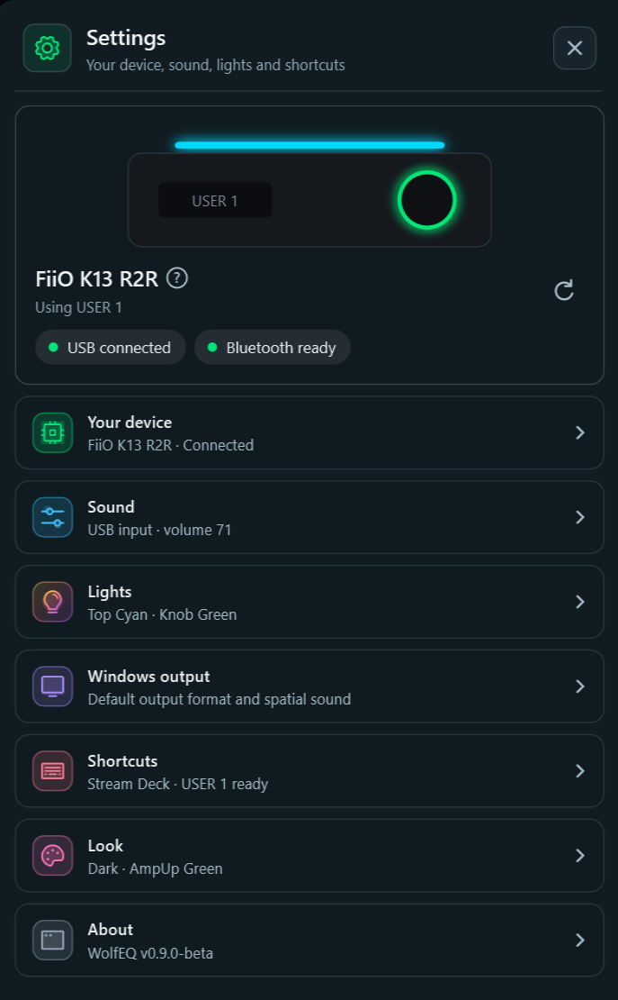

# 🎧 WolfEQ 0.9.0 beta — Lights, keys, and a friendlier Settings

Settings rebuilt around **your device**, a real lights editor, one-click Bluetooth, a Stream Deck guide, four more FiiO devices, and a faster, calmer app everywhere.

## ✨ Highlights

- 🎛️ **Settings at a glance** — Opens on a live drawing of your K13 in its real light colours, with **USB connected** and **Bluetooth ready** chips. Everything else lives in colour-coded sections: Your device, Sound, Lights, Windows output, Shortcuts, Look and About.
- ❔ **Help where you need it** — Hover any **?** for a short, plain explanation. The walls of fine print are gone.
- 🌈 **A real lights editor** — Preview the top bar and knob, edit **Both**, **Top** or **Knob**, and pick any built-in effect: Solid, Breathing, Rainbow, Rainbow breathing or Follow audio. Two-tone looks (Neon Split, Sunset, Ice, Twilight) set both at once.
- 📶 **Bluetooth in one click** — **Find my K13** flashes your unit green and saves it when you say yes. No Windows pairing, no separate save step.
- ⌨️ **Stream Deck made easy** — Pick a slot from glowing Stream Deck-style keys, then follow a four-step guide that saves the shortcut and shows exactly where it goes.
- 🎧 **More FiiO devices** — Added the **K17**, **K19**, **FP3** and **Oak Nano**. The **QX13** and **BTR17** are now recognised by their USB IDs. Every listed device is now labelled working.

## 🛠️ Also new

- **Clipping risk** sits right next to its **Avoid clipping** fix in the preamp strip.
- **Sound** has its own section: input, volume, volume limit, balance and high gain, each with a **?** tip.
- Matching headers, buttons and spacing across the editor, Library, Settings and dialogs. Small text is bigger and easier to read.
- Library filter chips, empty states and the **Fits 10 bands** tip are clearer. "1 saved presets" is now grammatical.
- The **Library** and **Settings** buttons have green icons and a soft highlight for the open panel.

## 🐞 Fixed

- ⚡ **Fast on every PC** — WolfEQ no longer opens every USB device on your computer before each action. On some PCs that added over a minute to every detection, slot switch and readback. ([#5](https://github.com/audioslayer/wolfeq/issues/5))
- 💡 **Lights after a restart** — If Windows hasn't seen your K13 over Bluetooth yet, WolfEQ listens for it for a few seconds and retries, so slot lighting works without pressing Scan. Thanks to **derailius** for the patch. ([#4](https://github.com/audioslayer/wolfeq/issues/4))
- 🔊 **Volume** — The Sound volume slider now finds your K13's Windows output. It used to fail with an `IMMDeviceCollection` or "RETRO NANO" error.
- 💾 **Saving Bluetooth** — Saving your Bluetooth device is no longer blocked by unsaved EQ edits.
- 🎨 **Lights stay honest** — If the K13 doesn't accept a light change, the editor goes back to what's really on the device.

## ⚠️ Good to know

- The K13 R2R is the device tested on hardware by WolfEQ. Devices marked **save-only** in the README write EQ to USER slots but keep live sync and automatic readback off until their USB behaviour is confirmed. Using one? Please tell us how it goes.
- If a K17 or K19 turns out to use USB serial instead of HID, it won't be detected yet.
- Sound › Volume sets the Windows playback volume for your device.

## 🚀 Downloads

| Asset | Use it for |
|---|---|
| **WolfEQ-Setup-0.9.0-beta.exe** | Install on Windows 10/11 x64. |
| **WolfEQ-0.9.0-beta-win-x64.zip** | Portable: extract everything and run WolfEQ.exe. |
| **SHA256SUMS.txt** | Verify your download. |

Both include the .NET runtime and the official Equalizer APO 1.4.2 installer. Equalizer APO is a separate GPL-2.0 program by Jonas Thedering, bundled unmodified; see THIRD_PARTY_NOTICES.md. Your presets, settings and saved devices carry over.

---

💚 Tell us how it sounds in the [WolfEQ Discord channel](https://discord.gg/nvkCRtK2Hf) or [report an issue](https://github.com/audioslayer/wolfeq/issues).
