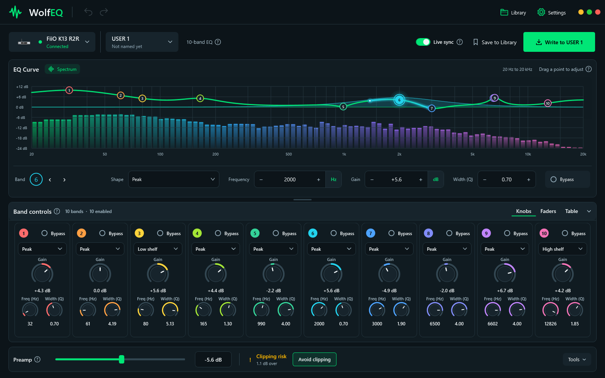

# 🎧 WolfEQ 1.0 — Every band in color

WolfEQ reaches 1.0. Every band has its own color, your cursor becomes part of the knob you turn, and 19 devices are supported, including the first from outside FiiO.

## ✨ New

- 🌈 **A color for every band** — Graph points, knobs, faders and the band editor share one color per band, warm lows to cool highs.
- 🎚️ **Knobs** — The new default Band controls view. Your cursor flies into the knob and the light follows it around the dial. Type exact values any time.
- 🪽 **Width wings** — The selected band's wings follow the curve. Drag a tip, or scroll even while dragging a point, to make it wider or narrower.
- 🔢 **Live readout** — Frequency, gain and Q appear beside a point as you drag it.
- 🎧 **More devices** — TRN Black Pearl, CrinEar Protocol Max, Tanchjim SPACE II, JadeAudio JIEZI and Snowsky Tiny A. On the first three, every save is read back and checked.
- 🖼️ **Real pictures** — Every device has its own picture.
- 🎛️ **Tidier settings** — Settings show only what your device supports. Volume limit, balance and high gain are gone: the K13 did not respond to them from a PC.

## 🐞 Fixed

- 🔊 **KA15, JA11 and Melody level** — Saved EQs played 12 dB too quiet. The preamp now matches what you set, from -24 to 0 dB.
- 🛡️ **Safer saving on BTR17, K17 and K19** — These now save with FiiO's standard command. The old one is a factory reset on other FiiO models, so please update before saving to these.
- 📶 **Bluetooth stays saved** — If Windows gives your device a new USB path, picking it again keeps its Bluetooth, slot names and lights.
- ⏱️ **KA15 and JA11** — Loading from a slot no longer waits on a command these devices never answer.
- 📏 **Retro Nano** — Corrected width limits and filter list.

## ⚠️ Good to know

- **KA15, JA11 and Melody owners:** your next save will sound about 12 dB louder than before. **Turn the volume down first.**
- WolfEQ is developed on the K13 R2R. The other devices build on published work by Contour, DevicePEQ and fiioctl. Using one? Start with a low-gain EQ and tell us how it goes, especially on the BTR17, K17 and K19: check that your EQ is still there after a power cycle.
- The TRN Black Pearl only appears in Windows with headphones plugged in.
- **Coming from 0.9?** If WolfEQ says your saved device is unavailable, pick it again from the device menu.

## 🚀 Downloads

| Asset | Use it for |
|---|---|
| **WolfEQ-Setup-1.0.0.exe** | Install on Windows 10/11 x64. |
| **WolfEQ-1.0.0-win-x64.zip** | Portable: extract everything and run WolfEQ.exe. |
| **SHA256SUMS.txt** | Verify your download. |

Both include the .NET runtime and the official Equalizer APO 1.4.2 installer. Equalizer APO is a separate GPL-2.0 program by Jonas Thedering, bundled unmodified; see THIRD_PARTY_NOTICES.md. Your presets, settings and saved devices carry over.

---

💚 Tell us how it sounds in the [WolfEQ Discord channel](https://discord.gg/nvkCRtK2Hf) or [report an issue](https://github.com/audioslayer/wolfeq/issues).
